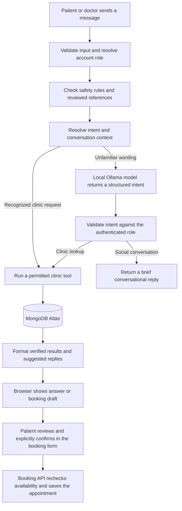

# MediCare

MediCare is a healthcare appointment and clinic management application. It brings together a patient website, a doctor workspace, administration and staff portals, and a local AI assistant for finding clinic information and preparing appointments.

The React applications and API run on **localhost**, clinic records are stored in **MongoDB Atlas online**, and AI inference runs locally through **Ollama**. The default model is **Qwen 2.5 1.5B** (`qwen2.5:1.5b`). New bookings use **Bangladeshi taka (BDT)**.

## Features

### Patients and visitors

- Browse and search doctors, specialties, consultation fees, and services.
- View doctor profiles and published weekly appointment times.
- Book doctor visits and services, with cash or Stripe checkout where configured.
- Sign in with Clerk to view personal appointment history, payment details, and booking status, and cancel eligible bookings.
- View and print completed laboratory results associated with the patient's account.
- Submit contact messages through the website.
- Ask the assistant to find doctors, check available times, and prepare a booking for confirmation.

### Doctors

- Sign in to a dedicated doctor portal using email and password.
- Review their own appointments, patient details, and revenue summaries.
- Manage appointment status, rescheduling, and clinical notes.
- Publish recurring weekly schedules and update availability, profile information, images, and consultation fees.
- Create laboratory orders linked to their own patient appointments.
- Use a personal assistant context to ask about upcoming visits, assigned patients, weekly availability, and saved appointment notes.

Each doctor's assistant uses the same local model, with access restricted to that doctor's verified account and records.

### Administration and staff

| Role | Workspace features |
| --- | --- |
| Administrator | Doctor and service management, appointments, payments and revenue views, staff accounts, duties, laboratory coordination, recruitment, announcements, and freelancer assignments. |
| Nurse | Personal duty schedule, assigned patient context, announcements, and profile. |
| Pathologist | Service requests, assigned laboratory orders, sample/status workflow, result submission, announcements, and profile. |
| HR | Workforce directory, duty planning, job openings, applicant review, announcements, and freelancer coordination. Clinical appointment details are omitted from HR schedule responses. |
| Freelancer | Personal assignments, assignment status updates, announcements, and profile. |

The admin and staff portals share the `admin` codebase. Access is checked by the backend as well as the interface.

## Technology and tools

Versions below describe the main package families used in this repository. The package lockfiles contain the exact installed dependency versions.

| Area | Technology | Purpose |
| --- | --- | --- |
| Frontend | React 19, React Router 7 | Patient, doctor, admin, and staff interfaces and navigation. |
| Styling | Tailwind CSS 4, custom CSS, Lucide icons | Responsive layouts, dialogs, forms, and icons. |
| Build tools | Vite 8, npm | Local development servers and production frontend builds. |
| API | Node.js, Express 5 | REST endpoints, validation, authentication, and application workflows. |
| Database | MongoDB Atlas, Mongoose 9 | Clinic records, schemas, queries, and appointment-slot uniqueness. |
| Authentication | Clerk, JSON Web Tokens, bcryptjs | Patient/admin sessions, doctor/staff sessions, and password hashing. |
| Payments | Stripe | Online checkout and payment confirmation. |
| File uploads | Multer, Cloudinary | Multipart uploads and hosted profile/catalog images. |
| Local AI | Ollama, Qwen 2.5 1.5B | Local intent interpretation and conversational replies. |
| MCP | `@modelcontextprotocol/server`, `@modelcontextprotocol/node` | Authenticated Streamable HTTP access to clinic tools. |
| Configuration | dotenv, Vite environment variables | Backend secrets and public frontend settings. |
| Development checks | Node.js test runner, Oxlint, nodemon | Regression tests, frontend linting, and API restart during development. |

## Project structure

```text
Medicare/
|-- README.md
|-- Backend/
|   |-- assistant/        # Conversation routing, Ollama, verified tools, MCP
|   |-- config/           # MongoDB connection
|   |-- controllers/      # Clinic and operations workflows
|   |-- middlewares/      # Authentication, roles, uploads
|   |-- models/           # Mongoose schemas
|   |-- routes/           # REST and assistant endpoints
|   |-- scripts/          # Appointment-slot index migration
|   |-- tests/            # Backend regression tests
|   |-- utils/            # Scheduling, payments, validation, startup
|   `-- server.js         # Express entry point
|-- Frontend/
|   |-- src/components/   # Shared UI and assistant panel
|   |-- src/pages/        # Patient pages and doctor portal
|   |-- src/lib/          # API clients, sessions, formatting, validation
|   `-- .env.example
`-- admin/
    |-- src/auth/         # Admin/staff sessions and portal roles
    |-- src/components/   # Shared operations UI
    |-- src/pages/        # Admin and staff workspaces
    `-- src/lib/          # API client and formatting
```

There is no root `package.json`. Install dependencies and run scripts in the appropriate application directory.

## Local setup

### Requirements

- Node.js 22.12 or later in the 22.x series, or a newer compatible release, with npm. The current Vite dependency requires Node `^20.19.0 || >=22.12.0`.
- Access to the project's active MongoDB Atlas cluster and its database credentials.
- A Clerk application for patient and administrator authentication.
- Cloudinary credentials for image uploads and Stripe credentials for online checkout.
- Ollama and a downloaded local model to enable model-generated assistant replies.

Atlas, Clerk, Cloudinary, and Stripe need an internet connection. Local AI inference does not make the entire application work offline.

### 1. Install dependencies

Open a terminal in the project root. On the existing Windows setup this is `C:\Users\SHIKTO\Desktop\Medicare`.

```powershell
cd .\Backend
npm ci
cd ..\Frontend
npm ci
cd ..\admin
npm ci
cd ..
```

### 2. Configure environment files

Keep working `.env` and `.env.local` files when using the existing installation. For a new installation, create `Backend/.env` using your own service credentials:

```dotenv
MONGODB_URI=mongodb+srv://<database-user>:<url-encoded-password>@<cluster-host>/<database-name>?retryWrites=true&w=majority
CLERK_PUBLISHABLE_KEY=your-clerk-publishable-key
CLERK_SECRET_KEY=your-clerk-secret-key
JWT_SECRET=your-long-random-jwt-secret
CLOUDINARY_CLOUD_NAME=your-cloud-name
CLOUDINARY_API_KEY=your-cloudinary-api-key
CLOUDINARY_API_SECRET=your-cloudinary-api-secret
STRIPE_SECRET_KEY=your-stripe-test-secret-key
FRONTEND_URL=http://localhost:5173
PAYMENT_CURRENCY=BDT
ASSISTANT_ENABLED=true
ASSISTANT_OLLAMA_URL=http://127.0.0.1:11434
ASSISTANT_MODEL=qwen2.5:1.5b
```

Copy `Frontend/.env.example` to `Frontend/.env` only if a frontend configuration does not already exist, then set the Clerk publishable key:

```dotenv
VITE_CLERK_PUBLISHABLE_KEY=your-clerk-publishable-key
VITE_API_URL=http://localhost:4000
VITE_WORKFORCE_URL=http://localhost:5175
VITE_CURRENCY=BDT
```

**The admin application reads environment files from `Frontend/`, including `Frontend/.env.local`; it does not read `admin/.env`.** Both interfaces must use the same API and matching Clerk application. Values in `.env.local` can override `.env`.

Keep secret keys in `Backend/.env`. `VITE_*` values are exposed to the browser and must contain only public configuration. Environment files are ignored by Git. Restart the relevant servers after configuration changes.

### 3. Verify appointment-slot setup

The original Atlas database already has the required appointment-slot index installed. When setting up another database, check it from `Backend`:

```powershell
node scripts/migrateAppointmentSlots.js --check
```

This command is read-only. If the index is missing and there are no conflicting or invalid active records, install it against the intended database:

```powershell
npm run db:migrate:appointment-slots
```

The migration installs a unique active doctor/date/time index without changing appointment records. It refuses to proceed when conflicts or invalid records exist. Doctor booking and rescheduling require this index. See [appointment-slot migration](Backend/APPOINTMENT_SLOTS.md).

### 4. Start the applications

Open each terminal in the project root, then run its commands. Leave the terminals open while using the project.

**Terminal 1: API**

```powershell
cd .\Backend
npm start
```

**Terminal 2: patient website and doctor portal**

```powershell
cd .\Frontend
npm run dev
```

**Terminal 3: administrator portal**

```powershell
cd .\admin
npm run dev
```

**Terminal 4: staff portal, when needed**

```powershell
cd .\admin
npm run dev:staff
```

| Application | Local address |
| --- | --- |
| API | http://localhost:4000 |
| Patient website | http://localhost:5173 |
| Doctor sign-in | http://localhost:5173/doctor/login |
| Administrator sign-in | http://localhost:5174/admin/login |
| Staff portal directory | http://localhost:5175/login |

The backend starts listening only after its configured database connects. A database connection failure does not switch to local MongoDB. A local MongoDB server is not required for the Atlas setup.

### 5. Start the local AI model

On a new computer, install Ollama and download the default model:

```powershell
ollama pull qwen2.5:1.5b
```

Start the Ollama desktop application. Alternatively, run this in a separate terminal if Ollama is not already serving:

```powershell
ollama serve
```

Open **Ask MediCare** on the patient website or **My assistant** in the doctor portal. Check the configured model and availability at `http://localhost:4000/api/assistant/status`.

The existing development PC also has `qwen2.5:3b` installed as an optional model. To try it, set `ASSISTANT_MODEL=qwen2.5:3b` in `Backend/.env` and restart the API. On another PC, download it with `ollama pull qwen2.5:3b` first. Larger models require more memory and may respond more slowly; the current default remains `qwen2.5:1.5b`.

## Accounts and access

| Account | Authentication and setup |
| --- | --- |
| Patient | Clerk sign-up/sign-in from the patient website. |
| Administrator | Clerk sign-in at `/admin/login`; the account needs server-managed public metadata `{ "role": "admin" }`. Signing in alone does not grant admin access. |
| Doctor | Email/password login using a doctor account created by an administrator. |
| Nurse, pathologist, HR, freelancer | Email/password accounts created through Staff Management, with the assigned role and an initial password. |

Staff login routes are `/nurse/login`, `/pathologist/login`, `/hr/login`, and `/freelancer/login` on port 5175. Staff use JWT authentication and do not require Clerk configuration for their own login.

An optional local administrator bypass is disabled by default and is rejected in production. Its explicit development-only setup is documented in the [admin and staff guide](admin/README.md).

## AI assistant and MCP

### What runs locally and what uses the internet

The assistant combines conversation routing, local model inference, and validated clinic queries. Doctor names, fees, services, appointments, and available times come from the application's database. The model helps interpret wording and produce brief social replies; clinic facts are formatted from verified tool results.

| Component | Where it runs | Responsibility |
| --- | --- | --- |
| Chat interface | React patient/doctor application in the browser | Messages, suggested replies, appointment previews, and booking review form. |
| Conversation service | Local Express backend | Validate input, resolve the authenticated role, maintain workflow context, and select permitted actions. |
| LLM inference | Ollama on the backend computer | Interpret unfamiliar requests through a constrained JSON schema and generate short conversational replies. |
| Clinic tool service | Backend with Mongoose queries | Read current doctor, service, slot, appointment, and permitted patient information from MongoDB Atlas. |
| MCP transport | Express endpoint on port 4000 | Expose the shared tool service to authenticated external MCP clients. |
| Patient authentication | Clerk | Verify patient sessions before private reads and booking confirmation. |

The current assistant does not use an OpenAI or other hosted inference API. It uses the default local model `qwen2.5:1.5b` through Ollama's `/api/chat` endpoint. Atlas and Clerk remain online services. Selected conversation history and workflow context may be included in local inference requests; keeping inference local does not remove the need to protect the backend computer.

### How a chat request works



1. The frontend sends the current message, a limited recent history, and a small conversation-state object to `/api/assistant/chat`.
2. The backend resolves the account from authentication. A message mentioning a doctor cannot change a patient's role.
3. Emergency and medication rules, reviewed education topics, and known clinic intents are checked before unfamiliar wording is sent to the model.
4. When model interpretation is needed, the backend requests JSON matching a role-specific intent schema. The returned intent is checked again in application code.
5. Clinic requests use validated tools. User-supplied state and model output are treated as hints; identifiers, availability, dates, and ownership are verified against current records.
6. Database-backed replies use short summaries, with suggested follow-ups and appointment previews when relevant. The model cannot make a booking succeed by saying it is complete.

### Conversation examples and context

| Example message | Intended behavior |
| --- | --- |
| "I have a skin problem" | Offer dermatologist lookup for an ordinary skin concern. Diagnosis, treatment, and urgent symptoms follow separate handling. |
| "Do you have any dermatologist?" | Search real clinic doctors and show matching profiles and fees. |
| "nxt avaiable time" | Continue with the selected doctor and check upcoming availability while retaining the patient role. |
| "Tomorrow" / "the second one" / "10am" | Use the current workflow to resolve the date, offered doctor/appointment, or time, then validate the selection. |
| "My appointments" | For a signed-in patient, read only bookings created by that patient account. |
| "Who is my next patient?" | For a signed-in doctor, summarize the next active appointment in the requested window. |
| "My schedule today" | For a signed-in doctor, show that doctor's appointments for today in Bangladesh time. |
| "Show my completed appointments" | Use an explicit history/status view instead of mixing completed visits into upcoming visits. |
| "What should I bring to my appointment?" | Return a reviewed preparation response with its source link. |

Conversation state can retain the topic, selected doctor, specialty, date, time, and the choices recently offered. Ambiguous selections prompt clarification. Changing the doctor or date clears stale selections when needed. Missing published appointment times are distinguished from a particular day having no free slots.

History and workflow state live in component memory. They clear on account changes, page reload, or **Start a new chat**. Assistant conversations are not stored in MongoDB or browser storage. The UI includes response cancellation, connection status, suggested replies, and separate conversation/booking tabs for patients.

### Booking through the chatbot

The assistant currently prepares **doctor-appointment drafts**. It can also look up clinic services; service bookings continue through the existing service pages.

1. Find a doctor by name, specialty, or supported care-navigation request.
2. Choose a date or ask for the next available time. Slot queries check published weekly times, the doctor's availability, elapsed times, and occupied slots.
3. Choose an offered time. `prepare_booking` returns a draft with the doctor, date, time, fee, currency, and confirmation requirements.
4. Open **Review details** or the **Book appointment** tab. A visitor must sign in before entering patient details and confirming.
5. Review the patient name, mobile number, optional age/notes, consultation fee, and payment method, then click **Confirm appointment**.
6. The normal booking API verifies the patient session and slot again. Paid online bookings continue to Stripe checkout; cash/free bookings follow their existing flow.

A draft does not reserve a time. If another patient takes the slot, the server returns a conflict and the form refreshes available alternatives. Even typing "confirm" or "book it" in chat only advances draft preparation; the form is the action that submits the booking.

### Each doctor's assistant

Doctors share one installed model, while each request receives context for the verified doctor. There is no separate trained model or long-term chat memory for each doctor.

- **Schedule:** Read the doctor's published weekly working times and appointments. A recurring working time is not automatically a free appointment.
- **Upcoming patients:** Summarize appointments assigned to that doctor, with the next visit first and additional details available on request.
- **Saved notes:** Read patient/doctor notes for a selected owned appointment and laboratory records ordered by that same doctor for that appointment.
- **Account isolation:** Private query filters use the authenticated doctor's identity. A supplied appointment ID or model instruction cannot grant access to another doctor's records.

Upcoming views omit elapsed, completed, and canceled appointments. Explicit history requests can include them. A patient account cannot access doctor-only tools, and the assistant is currently available to visitors, patients, and doctors rather than the other staff portals.

### Health information and sources

The assistant includes a small, manually maintained reference library covering appointment preparation, medicine safety, laboratory-test preparation, understanding laboratory reports, diabetes, and high blood pressure. Responses include specific MedlinePlus, WHO, or NHS links. Dermatology navigation uses a reviewed specialty definition from the American Academy of Dermatology.

These references are stored in the code; the assistant does not browse medical websites during a conversation or search a vector database. Unsupported clinical questions receive a bounded response and guidance to consult a clinician. The current implementation does not independently diagnose, prescribe, interpret a patient's report as a clinical decision, or provide personalized dosing. Emergency and medication rules take priority over ordinary booking navigation.

### What MCP adds

MCP means **Model Context Protocol**. It gives a compatible external assistant/client a standard way to discover and call MediCare's validated tools. Ollama runs the language model; MCP exposes clinic capabilities. The React chatbot calls the shared tool service internally through its chat workflow, so opening the website does not require configuring an external MCP client.

The project uses `@modelcontextprotocol/server` and `@modelcontextprotocol/node` for an actual **stateless Streamable HTTP** endpoint:

```text
http://localhost:4000/api/assistant/mcp
```

Each HTTP request creates a server bound to the verified account. Tool discovery is filtered by role, and execution checks permissions again. Tools use explicit JSON schemas and structured results, with read-only annotations. Arbitrary MongoDB queries and write tools are not exposed.

### MCP tool catalog

The access column below describes the **external MCP endpoint**, which always requires a patient or doctor account. Public website chat can additionally use doctor/service/slot lookup and draft preparation as a visitor.

| Tool | Main arguments | MCP access | Result |
| --- | --- | --- | --- |
| `find_doctors` | Optional `query`, `specialization`, `limit` | Patient, doctor | Matching public profiles, specialties, consultation fees, availability, and booking links. |
| `list_services` | Optional `query`, `limit` | Patient, doctor | Published services, prices, bounded descriptions, instructions, and page links. |
| `get_available_slots` | Required `doctorId`, `date` | Patient, doctor | Currently unbooked times for one date, timezone, and published-schedule metadata. |
| `prepare_booking` | Required `doctorId`, `date`, `time` | Patient | Draft with `requiresConfirmation`; no appointment is created. |
| `my_appointments` | Optional `from`, `to`, `limit`, `view`, `status` | Patient | Only appointments created by that patient account. |
| `my_schedule` | Optional `from`, `to`, `limit`, `view`, `status` | Doctor | The doctor's recurring schedule and owned appointments. |
| `my_patients` | Optional `from`, `to`, `limit`, `view`, `status` | Doctor | Minimal details from appointments assigned to that doctor; entries count appointments, not unique patients. |
| `get_patient_context` | Required `appointmentId` | Doctor | Owned appointment notes and doctor-scoped laboratory records for that appointment. |

Slot queries accept dates from today through 90 days ahead in `Asia/Dhaka`. List tools accept a `limit` from 1 to 50. Private date windows are capped at 93 days within approximately one year of today. Defaults are seven calendar days for `my_schedule` and 30 for the other private list tools; `my_patients` with `view: "all"` defaults to the last 30 days.

Private list results include metadata such as `total`, `truncated`, `countIsExact`, and the selected date window. Reads are capped at 500 matching appointments; when the count is not exact, treat `total` as a lower bound. `view: "upcoming"` is the default. Use `view: "all"` for history, including explicit `Completed` or `Canceled` status filters.

### Connect an external MCP client

Use a client that supports **Streamable HTTP** and a configurable authorization header:

| Setting | Value |
| --- | --- |
| Endpoint | `http://localhost:4000/api/assistant/mcp` |
| Authorization | `Bearer <current-application-token>` |
| Patient token | Current Clerk session token. |
| Doctor token | Current JWT issued by the doctor login endpoint. |
| Content type | `application/json` |
| Accept | `application/json, text/event-stream` |
| Protocol version used by the project checks | `2025-11-25` |

This endpoint uses existing application authentication rather than a separate MCP OAuth discovery/login flow. Guests, staff/admin accounts, local development bypasses, and expired tokens cannot access it. Tokens expire and must be refreshed by the client.

For a local PowerShell protocol check, provide your own current token privately in the terminal environment as `MEDICARE_MCP_TOKEN`, then run:

```powershell
$headers = @{
  Authorization = "Bearer $env:MEDICARE_MCP_TOKEN"
  Accept = 'application/json, text/event-stream'
  'MCP-Protocol-Version' = '2025-11-25'
}
$endpoint = 'http://localhost:4000/api/assistant/mcp'

# Initialize the client connection.
$body = '{"jsonrpc":"2.0","id":1,"method":"initialize","params":{"protocolVersion":"2025-11-25","capabilities":{},"clientInfo":{"name":"medicare-local-check","version":"1.0.0"}}}'
Invoke-RestMethod -Method Post -Uri $endpoint -Headers $headers -ContentType 'application/json' -Body $body

# Discover tools available to this account.
$body = '{"jsonrpc":"2.0","id":2,"method":"tools/list","params":{}}'
Invoke-RestMethod -Method Post -Uri $endpoint -Headers $headers -ContentType 'application/json' -Body $body

# Perform a public-profile lookup using the authenticated connection.
$body = '{"jsonrpc":"2.0","id":3,"method":"tools/call","params":{"name":"find_doctors","arguments":{"query":"dermat","limit":3}}}'
Invoke-RestMethod -Method Post -Uri $endpoint -Headers $headers -ContentType 'application/json' -Body $body
```

The stateless endpoint accepts POST requests and one JSON-RPC message at a time, with a 32 KB MCP request-body limit. Host and Origin checks restrict access to configured origins. For a future deployment, configure exact comma-separated `ASSISTANT_MCP_ALLOWED_HOSTS` and `ASSISTANT_MCP_ALLOWED_ORIGINS` values, serve the application through HTTPS, and retain account authentication. Ollama itself should remain on the backend computer's loopback interface.

### Chat API and model settings

| Endpoint | Purpose |
| --- | --- |
| `GET /api/assistant/status` | Report provider, configured model, local mode, availability, and a readiness message. |
| `POST /api/assistant/chat` | Process a website conversation as a visitor or authenticated patient/doctor. |
| `POST /api/assistant/mcp` | Handle authenticated MCP initialization, tool discovery, and tool calls. |

Website chat accepts the following shape. Send the previous response's `conversation` object back on follow-up requests instead of constructing private identities in it:

```json
{
  "message": "I have a skin problem",
  "history": [],
  "conversation": {}
}
```

Successful chat responses use `{ "success": true, "data": { ... } }`. The data includes `reply`, `role`, `model`, `toolsUsed`, `sources`, and `conversation`. Depending on the request, it can also include `suggestions`, `appointments`, `bookingDraft`, `generated`, `verifiedClinicData`, or `verifiedReference`. These flags describe the response path; a booking draft still requires form confirmation.

Messages are limited to 2,000 characters. The API accepts at most eight user/assistant history entries, each up to 2,000 characters, with a combined 10,000-character limit. Client-provided system/tool messages are rejected. The frontend sends a smaller recent-history budget, and model planning uses a further bounded excerpt. The assistant routes apply a 60-request per 10-minute rate limit per authenticated actor, or by connection address for guests/status checks.

| Backend environment variable | Default | Purpose |
| --- | --- | --- |
| `ASSISTANT_ENABLED` | `true` | Set to `false` to disable model inference; direct lookup paths remain separate. |
| `ASSISTANT_OLLAMA_URL` | `http://127.0.0.1:11434` | Local Ollama HTTP endpoint; only loopback addresses are accepted. |
| `ASSISTANT_MODEL` | `qwen2.5:1.5b` | Installed local model name. |
| `ASSISTANT_MCP_ALLOWED_HOSTS` | Local API hosts | Additional exact MCP Host values for a deployment. |
| `ASSISTANT_MCP_ALLOWED_ORIGINS` | Local patient origins plus configured frontend URL | Additional exact MCP origins; also used by endpoint-specific CORS configuration. |

The Ollama adapter uses non-streamed responses, temperature `0.15`, a 4,096-token context setting, up to 220 generated tokens, and a five-minute model keep-alive. These generation settings are currently defined in `Backend/assistant/ollama.js`, rather than separate environment variables. Generation has a 90-second timeout and allows one concurrent model request to suit the current development PC.

The backend checks model installation and metadata, rejecting cloud model names and cloud-backed aliases. Common doctor/service lookups, known schedule questions, and booking forms can still work when Ollama is offline, as long as the API, database, and required authentication are available. Unfamiliar wording may require clarification when inference is unavailable.

### Implementation files and verification

| File | Responsibility |
| --- | --- |
| [AssistantPanel.jsx](Frontend/src/components/AssistantPanel.jsx) | Chat drawer, memory-only history, suggested replies, doctor previews, booking review, and confirmation. |
| [assistantApi.js](Frontend/src/lib/assistantApi.js) | Browser requests, bearer headers, timeouts, cancellation, and readable errors. |
| [assistantRouter.js](Backend/routes/assistantRouter.js) | HTTP endpoints, authentication/role gates, rate limits, and response cache policy. |
| [chat.js](Backend/assistant/chat.js) | Conversation orchestration, model planning, runtime role checks, and verified reply formatting. |
| [conversation.js](Backend/assistant/conversation.js) | Intent rules, spelling normalization, specialty navigation, follow-ups, and date/time selection. |
| [knowledge.js](Backend/assistant/knowledge.js) | Reviewed health references and emergency/medication response rules. |
| [ollama.js](Backend/assistant/ollama.js) | Local model configuration, readiness checks, inference requests, timeout, and capacity limit. |
| [tools.js](Backend/assistant/tools.js) | Tool schemas, validated arguments, ownership filters, database reads, and booking drafts. |
| [mcp.js](Backend/assistant/mcp.js) | Stateless MCP server, transport, Host/Origin checks, discovery, and tool execution. |

From `Backend`, run the assistant regression checks with:

```powershell
node --test tests/assistantChat.test.js tests/assistantConversation.test.js tests/assistantRouting.test.js tests/assistantTools.test.js tests/assistantMcp.test.js tests/assistantKnowledge.test.js
```

These checks cover follow-up routing, patient/doctor separation, ownership, current-slot validation, draft-only preparation, bounded health responses, local-model restrictions, inference failures, and real MCP HTTP transport. See [assistant and MCP documentation](Backend/ASSISTANT.md) for further operational details.

## API overview

| Route group | Responsibility |
| --- | --- |
| `/api/doctors`, `/api/doctor-portal` | Doctor directory, authentication, profiles, schedules, and doctor appointments. |
| `/api/services` | Service catalog and management. |
| `/api/appointments`, `/api/service-appointments` | Bookings, status changes, and payment flows. |
| `/api/auth`, `/api/staff` | Current actor, staff accounts, and staff authentication/profile management. |
| `/api/shifts`, `/api/dashboard` | Duty planning and role-specific summaries. |
| `/api/lab-tests` | Laboratory orders, assignments, status, and results. |
| `/api/jobs`, `/api/applicants` | Job openings, applications, and applicant review. |
| `/api/announcements`, `/api/freelancer-assignments` | Workforce communications and assignments. |
| `/api/contact` | Save website contact submissions. |
| `/api/assistant/status`, `/api/assistant/chat`, `/api/assistant/mcp` | Model readiness, website chat, and MCP transport. |

Public catalog and submission endpoints coexist with protected endpoints. Private operations enforce account roles and record ownership on the server.

## Currency and scheduling

New prices and payments use **BDT**. Keep backend `PAYMENT_CURRENCY=BDT` and frontend `VITE_CURRENCY=BDT` aligned. Changing the currency setting does not convert numeric catalog prices.

Historical online payments retain INR where that was the actual checkout currency. Revenue summaries separate currencies instead of combining them or implying an exchange-rate conversion. Canceling an appointment does not automatically issue a Stripe refund. See [payment behavior](Backend/PAYMENTS.md).

The assistant interprets dates and checks slot availability in `Asia/Dhaka`. Published weekly working times are checked against actual bookings before a slot is offered or confirmed. Concurrent attempts to reserve an occupied doctor slot return a conflict response.

## Checks and builds

Run these commands from their listed directories:

| Directory | Command | Purpose |
| --- | --- | --- |
| `Backend` | `npm test` | Backend regression suite, including authentication, bookings, payments, startup, assistant routing, and MCP. |
| `Frontend` | `node --test src/lib/format.test.js src/lib/api.test.js` | Frontend formatting, API, validation, and payment regressions. |
| `Frontend` | `npm run lint` | Frontend source checks. |
| `admin` | `npm run lint` | Admin/staff source checks. |
| `Frontend` | `npm run build` | Patient/doctor production bundle in `Frontend/dist`. |
| `admin` | `npm run build` | Admin/staff production bundle in `admin/dist`. |

Each frontend also has `npm run preview` to inspect its production build locally. The backend start script uses nodemon for development; `node server.js` starts the API directly from `Backend`. Frontend builds do not start the API or configure hosting for external services.

## Troubleshooting

| Problem | What to check |
| --- | --- |
| "API port is already in use" | Another process is listening on port 4000. Reuse the running API or stop its original terminal with `Ctrl+C` before starting another copy. |
| Vite opens on a different port | Stop a duplicate frontend process and restart on the documented port; API CORS is configured for the local app origins above. |
| Atlas DNS or connection error | Check the cluster is active, the Atlas **Connect > Drivers** URI, database credentials, network access list, internet, and DNS. |
| API uses an old database value | A terminal environment variable can override `.env`. If it is an unwanted override, run `Remove-Item Env:MONGODB_URI -ErrorAction SilentlyContinue` in the API terminal, then restart. |
| Clerk login/configuration error | Check the frontend publishable key, matching backend Clerk keys, and administrator metadata where applicable. |
| Booking returns `BOOKING_INDEX_REQUIRED` | Check and install the appointment-slot index using the migration instructions above. |
| No appointment times for a doctor | Publish that doctor's weekly schedule and check availability; a profile alone does not create bookable times. |
| Assistant says Ollama is offline | Start Ollama, run `ollama list`, and confirm the model name matches `ASSISTANT_MODEL`. |
| Ollama port 11434 is already in use | The desktop app or another Ollama server may already be running; use that instance. |
| Assistant is busy or slow | Only one generation runs at a time. Initial model loading can take longer; wait for it to finish and use the default small model on limited hardware. |
| Upload or checkout fails | Check the relevant Cloudinary or Stripe configuration and the API error response. |
| Environment changes do not appear | Check `Frontend/.env.local` overrides and restart the affected API/Vite servers. Rebuild production bundles after changing frontend settings. |

## Current scope

The assistant helps users navigate clinic information and prepare appointments. It does not independently diagnose, prescribe, cancel visits, send notifications, or make background clinical decisions. It has no automatic reminder service. Contact submissions are saved to the database; the contact form does not send email.

Live payment, authentication, upload, and database behavior depends on the configured external services. Automated tests and successful frontend builds do not replace integration checks with those services.

## Further documentation

- [Patient website configuration](Frontend/README.md)
- [Administrator and staff portals](admin/README.md)
- [Local assistant and MCP setup](Backend/ASSISTANT.md)
- [Appointment-slot migration](Backend/APPOINTMENT_SLOTS.md)
- [Payments and historical currencies](Backend/PAYMENTS.md)
